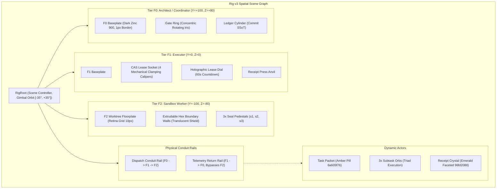

# Rig v3 Research: 3D System Storytelling for Coordinator↔Worker Containment

> **Document Status:** Research & Design Specification  
> **Target Path:** `docs/research/24-3d-storytelling-research.md`  
> **Scope:** Ground-up motion, interaction, and spatial choreography redesign for Act II (Rig v3). Zero code changes.

---

## 1. Problem Statement & The Operator Verdict

Rig v2 introduced real captured runtime parameters (`task 6a605f76`, `receipt 96fd2088`), but visually it failed the primary narrative requirement: **it reads as static tilted CSS cards with a sliding dot, not a living, physical distributed system.**
- **The Core Flaw:** The planes (`F2`, `F1`, `F0`) behave like stacked UI cards rather than spatial isolation chambers.
- **The Narrative Vacuum:** The dynamic relationship between **F0 (Architect/Coordinator)**, **F1 (Executor/Lease-holder)**, and **F2 (Sandbox/Worker)** is lost. The viewer cannot see that F0 *never* touches files directly, that F1 claims an atomic CAS lease, or that F2 executes inside an ephemeral worktree whose changes are gated behind an unforgeable cryptographic write receipt.
- **Objective:** Redesign Rig v3 as an authentic 3D spatial rig where system telemetry drives mechanical motion, physical conduits, and unforgeable state transitions.

---

## 2. External Benchmarks & References (W1–W3)

### 2.1 Concrete Reference Sites & Repositories (W1)

| Benchmark / URL | Architectural Focus | One-Line "What to Steal" |
| :--- | :--- | :--- |
| **Vasturiano 3D Force Graph**<br>`https://github.com/vasturiano/3d-force-graph`<br>`https://vasturiano.github.io/3d-force-graph/example/directional-links-particles/` | Directed particle flow along Bezier curves | **Directional Bezier Packet Pipelines:** Spawn particles on 3D spline curves with velocity proportional to runtime latency; batch renders via instanced points. |
| **Stripe Radar Security Stack**<br>`https://stripe.com/radar` | Multi-tier defense descent & gate inspection | **Vertical Tier-to-Tier Gravitational Drop:** Payloads descend vertically through transparent security stages; each layer activates a perimeter ring before allowing passage. |
| **Cilium Hubble UI Service Map**<br>`https://github.com/cilium/hubble-ui` | eBPF kernel packet flow & policy topology | **Trust Boundary Edge Coloring:** Conduits visibly change state (amber in-transit, neon-cyan verified, crimson blocked) as packets cross cryptographic boundaries. |
| **Kiali Service Mesh Visualizer**<br>`https://kiali.io/docs/features/topology/` | Microservice traffic choreography | **Queue-and-Latch Rhythms:** Packets do not flow continuously; they queue at nodes, latch into sockets during processing, and fire in rhythmic bursts. |
| **GitHub Next Repo Visualization**<br>`https://githubnext.com/projects/repo-visualization/` | Codebase clustering & depth navigation | **Ephemeral Enclosure Extrusions:** Boundary enclosures (like worktrees) dynamically project upward from floorplates when active and collapse flat when pruned. |
| **Three.js Instanced Dynamic Mesh**<br>`https://threejs.org/examples/#webgl_instancing_dynamic` | Zero-allocation WebGL rendering loop | **Batched Draw Calls:** Single-pass matrix transformations for packets, seals, and conduits to prevent mobile garbage-collection pauses. |

### 2.2 Motion Vocabulary & Rhythm Choreography (W2)

Professional 3D choreography treats system software as mechanical hardware:
1. **Spawn / Arrive / Depart Dynamics:**
   - *Spawn (Brief Dispatch):* Anticipatory scale compression (0.85×, 80ms) followed by snappy explosive release (`cubic-bezier(0.16, 1, 0.3, 1)`, 320ms) into the conduit.
   - *Travel (Conduit Transit):* Asymmetric velocity curve (`cubic-bezier(0.45, 0, 0.15, 1)`). Vertical drops use a gravity curve (steep acceleration downward, abrupt deceleration into the target socket).
   - *Arrive (Socket Latch):* High-energy mechanical impact (`cubic-bezier(0.34, 1.56, 0.64, 1)`, 200ms) with zero floating overshoot, triggering a microscopic plane vibration (0.5px displacement, 60ms decay).
   - *Depart (Evidence Ascension):* Elastic launch upward (`cubic-bezier(0.7, 0, 0.84, 0)` acceleration into ease-out).
2. **Attention Management (The Single-Focus Invariant):**
   - *Only one primary actor moves at full velocity at any given millisecond.*
   - While the packet is in flight, node platforms maintain structural stability. When a node changes state (e.g., F1 lease lock), the packet halts, centering viewer attention on the socket mechanism.
3. **Calibrated Duration Bands:**
   - **Micro-Reactions (150ms class: 120–180ms):** Seal punch impact, chip toggle, gate tick, socket clamp release.
   - **Tactical Transitions (400ms class: 350–450ms):** Inter-tier conduit flight, CAS lease countdown step, worktree boundary wall extrusion.
   - **Macro Evolutions (800ms class: 750–1000ms):** Camera focal repositioning, full rig cycle reset, receipt crystallization sequence.

### 2.3 Interaction Paradigms for Graph Scenes (W3)

- **Hover-Reveal:** Hovering a tier node elevates its platform (+12px in Z), illuminates an OKLCH amber halo, and unveils an in-situ telemetry HUD (role, lease token, boundary rules). Inactive tiers dim to 25% opacity.
- **Click-to-Focus Camera:** Smooth slerp camera transition (`cubic-bezier(0.22, 1, 0.36, 1)`, 650ms) framing the selected tier in high-detail orthographic-perspective. `Esc` or clicking empty space triggers an ease-out glide back to isometric home.
- **Constrained Orbit vs Free Pan:** Free pan disorients viewers. Rig v3 enforces **Constrained Gimbal Orbit**: azimuth clamped to $[-35^\circ, +35^\circ]$, elevation clamped to $[20^\circ, 55^\circ]$. Pointer release engages inertial decay that gently returns to standard isometric ($35.26^\circ / 45^\circ$) after 1.5s of inactivity.
- **Keyboard Navigation:** `Tab` cycles focus sequentially: `F0 Coordinator` $\rightarrow$ `Dispatch Rail` $\rightarrow$ `F1 Executor` $\rightarrow$ `F2 Sandbox` $\rightarrow$ `Receipt Rail`. `Space`/`K` pauses the story loop; `1`, `2`, `0` snaps directly to corresponding containment tiers.
- **Scroll-Scrubbed Timelines:** In autonomous mode, the 12s narrative loop cycles continuously. When the user scrubs the timeline or drives scroll progress $t \in [0, 1]$, the loop scrub-locks the packet position, camera focus, and telemetry chips to the exact frame.

---

## 3. Motion Grammar: Domain Event Translation

Every distributed systems primitive defined in **g8s ADR-0032** maps to an unambiguous physical visual verb and acoustic stem from `tools-fxv5/score.py`:

| # | System Event (ADR-0032) | Visual Verb | Spatial Choreography | Duration & Easing | Audio Stem Pairing (`score.py`) |
| :-: | :--- | :--- | :--- | :--- | :--- |
| **E1** | **F0 Charter Issuance**<br>`task_submitted` | **`SPAWN & CHARGE`** | Glowing gold capsule (`6a605f76`) materializes at F0 center node; F0 perimeter status ring charges with amber light. | 380ms<br>`cubic-bezier(0.16, 1, 0.3, 1)` | `tick()` (1800Hz transient) + `pluck(D5, 0.9)` |
| **E2** | **F0 $\rightarrow$ F1 Dispatch**<br>Bus transit | **`PLUNGE & STRETCH`** | Capsule elongates along motion vector (aspect ratio 1:1.8), traveling down the primary conduit rail from $Z=120$ to $Z=0$. | 420ms<br>`cubic-bezier(0.5, 0, 0.2, 1)` | Filtered noise sweep (`sw`) ramp |
| **E3** | **F1 CAS Lease Claim**<br>`task_claimed` | **`LATCH & COUNTDOWN`** | Capsule snaps into F1 mechanical socket; four perimeter calipers lock inward. Holographic `60s` timer ignites and ticks. | 220ms snap<br>`cubic-bezier(0.34, 1.56, 0.64, 1)` | `clack(7701)` + `tick()` (relay snap) |
| **E4** | **Worktree Forking**<br>`Setpgid` isolation | **`EXTRUDE & ENCLOSE`** | Translucent hexagonal boundary wall extrudes vertically (+40px) from F2 floorplate, enclosing the sandbox area. | 550ms<br>`cubic-bezier(0.22, 1, 0.36, 1)` | `bass(D2, 0.20)` (73.4Hz fundamental) |
| **E5** | **Subtask Execution**<br>`task_started` | **`TRIAD ORBIT`** | Packet splits into 3 orbiting execution orbs inside F2 sandbox, depositing micro-particles on the worktree floor. | 2200ms<br>Orbital velocity $0.025\,\text{rad/frame}$ | Rhythmic `clack` train (typing grid, 4-frame delta) |
| **E6** | **Zero-Trust Checks**<br>Seals verified | **`PUNCH & RIPPLE`** | Three physical seal stamps (`s1`, `s2`, `s3`) punch into F2 floor plate sequentially (at +300ms, +700ms, +1100ms). | 140ms per stamp<br>`cubic-bezier(0.12, 0, 0.39, 0)` | Ascending ladder: `pluck(F5)` $\rightarrow$ `pluck(A5)` $\rightarrow$ `pluck(C6)` |
| **E7** | **Receipt Sealing**<br>`result_hash` sealed | **`CRYSTALLIZE`** | Orbs coalesce into F1 anvil press. Packet turns from amber to faceted emerald crystal embossed with `96fd2088`. | 480ms<br>`cubic-bezier(0.16, 1, 0.3, 1)` | `thump` (44Hz sub) + `pluck(D6, 0.7)` |
| **E8** | **Evidence Ascension**<br>Bypasses F2 | **`ASCEND & BYPASS`** | Sealed crystal launches upward along return telemetry rail directly to F0. Visually bypasses F2 (zero direct edge). | 580ms<br>`cubic-bezier(0.25, 1, 0.5, 1)` | Upward ledger sweep: `pluck(D4)` $\rightarrow$ `pluck(A4)` |
| **E9** | **Human Gate Confirm**<br>`attempt_finished` | **`PULSE & SCAN`** | Gold Gate Ring expands radially at F0, scanning the crystal. HUD displays: `5.86s · result_hash: 99bcdd7e`. | 750ms<br>`cubic-bezier(0.33, 1, 0.68, 1)` | `tick()` + `kick(0.5)` downbeat |
| **E10** | **Commit & Prune**<br>`WORKER_COMPLETED` | **`MERGE & FLATTEN`** | Crystal integrates into F0 ledger cylinder. Green pulse ripples through entire rig; F2 walls collapse; rig re-arms. | 650ms merge<br>`cubic-bezier(0.4, 0, 0.2, 1)` | `kick(0.5)` + `sin(D1)` sub + chord `[D5, A5, D6]` |

---

## 4. Rig v3 Design Specification



### 4.1 Mathematical Projection Model & Coordinate Geometry

Rig v3 models all components in continuous 3D world space $\mathbb{R}^3 = (x, y, z)$. Screen transformation uses an affine isometric projection matrix combined with an orbital gimbal rotation:
$$\begin{bmatrix} x' \\ y' \\ z' \end{bmatrix} = \mathbf{R}_{\text{pitch}}(\theta) \cdot \mathbf{R}_{\text{yaw}}(\phi) \cdot \begin{bmatrix} x \\ y - y_{\text{focus}} \\ z \end{bmatrix}$$
$$\text{screen}_x = c_x + (x' - z') \cdot \cos(30^\circ) \cdot s$$
$$\text{screen}_y = c_y + (x' + z') \cdot \sin(30^\circ) \cdot s - y' \cdot s$$
$$\text{depth} = x' + z' + 2y'$$

- **Depth-Sort Engine (Painter's Algorithm):** Polyline segments and platform primitives are sorted by computed $\text{depth}$ prior to every 60fps render pass, eliminating occlusion artifacts without WebGL depth buffers.
- **Conduit 3D Bezier Splines:**
  - *Dispatch Rail $\mathbf{B}_{\text{down}}(t)$:* Cubic Bezier from F0 $(0, 100, 80)$ through control points $(30, 60, 50)$ and $(15, 20, 10)$ to F1 $(0, 0, 0)$, then extending to F2 $(0, -100, -80)$.
  - *Telemetry Return Rail $\mathbf{B}_{\text{up}}(t)$:* Direct sweep from F1 $(0, 0, 0)$ looping laterally through $(-45, 40, 20)$ and $(-25, 80, 60)$ directly to F0 $(0, 100, 80)$.
  - *Crucial Physical Invariant:* The return rail is spatially separated by $\Delta X = -45\text{px}$, visually demonstrating that **F0 $\leftrightarrow$ F2 has zero direct edges**.

### 4.2 Camera Model Decision & Justification

- **Selected Model:** **Constrained Orthographic-Perspective Isometric with Inertial Damping** (`FOV 38°`, Base Pitch: $35.264^\circ$, Base Yaw: $45.0^\circ$).
- **Rejection of Free 3D Orbit:** Free trackball orbit allows viewers to flip the rig upside down, inverting telemetry labels and destroying the hierarchical F0 $\rightarrow$ F1 $\rightarrow$ F2 containment narrative.
- **Rejection of Fixed Static Isometric:** Pure static isometric looks like flat tilted cards (the exact operator complaint).
- **The Solution:** A constrained 3D gimbal with elastic damping. The camera smoothly tracks the vertical center of activity (gliding slightly down when F2 executes, rising back up when the receipt ascends to F0). Dragging gives immediate parallax feedback; releasing smoothly returns the camera to the canonical 45°/35.26° perspective.

### 4.3 Interaction States Matrix

| State | Tier F0 (Architect) | Tier F1 (Executor) | Tier F2 (Sandbox) | Task Packet (`6a605f76`) | Receipt Crystal (`96fd2088`) |
| :--- | :--- | :--- | :--- | :--- | :--- |
| **Idle** | Ambient pulse (0.1Hz); Gate Ring static | CAS socket backlit amber; standby glow | Floorplate grid faint (4% opacity); walls down | Follows ambient 12s timeline | Stored in ledger slot |
| **Hover** | Glows amber; displays charter authority HUD | Glows amber; displays CAS lease specs | Glows green; displays AllowedPaths rules | Pauses animation; displays task manifest tooltip | Glints emerald; shows cryptographic hash |
| **Click / Focus** | Camera slides to F0 ($Y=+80$); F1/F2 dim | Camera centers on F1 ($Y=0$); calipers detail | Camera tilts to F2 ($Y=-80$); walls light up | Pins inspection modal; freezes narrative loop | Opens verification receipt inspector |
| **Drag Orbit** | Platform tilts with 3D inertia | Platform tilts with 3D inertia | Platform tilts with 3D inertia | Tracks 3D coordinate along conduit | Maintains orientation to light source |
| **Scroll Scrub** | Timeline locked to scroll percentage $t$ | Countdown matches scrub position | Wall height mapped to execution phase | Position interpolated exactly to scroll $t$ | Opacity mapped to seal completion |
| **Keyboard** | Focused via `0`; `Enter` triggers drill | Focused via `1`; `Enter` triggers drill | Focused via `2`; `Enter` triggers drill | `Space` toggles pause/resume | `V` triggers verify command in terminal |

### 4.4 12-Second Ambient Loop Storyboard (30fps / 360 Frames)

- **00.0s – 01.2s (Frames 0–36):** **F0 Brief Generation.** F0 status ring blooms amber. Packet `6a605f76` materializes above F0 command plate. `c-f0` chip ignites. Note: `"F0 · task_submitted — brief issued · task 6a605f76"`.
- **01.2s – 02.0s (Frames 36–60):** **Conduit Plunge.** Packet stretches into high-speed conduit stream, dropping from F0 to F1 socket.
- **02.0s – 04.5s (Frames 60–135):** **F1 Atomic CAS Lease.** Mechanical calipers lock onto packet. Holographic `60s` timer ticks down ($60 \rightarrow 57\text{s}$). `c-lease` chip illuminates. Note: `"F1 · task_claimed — CAS lease claimed (token b9f379a2…)"`.
- **04.5s – 05.2s (Frames 135–156):** **F2 Sandbox Fork.** Translucent hexagonal boundary walls extrude vertically (+40px) from F2 floor plate.
- **05.2s – 07.5s (Frames 156–225):** **Execution Triad & Seal Stamp.** Packet splits into 3 orbiting orbs. Seal pedestals `s1`, `s2`, `s3` punch down at 5.7s, 6.3s, 6.9s. `c-work` chip active. Note: `"F2 · task_started — worktree wt-69c9b6e4 isolated · AllowedPaths enforced"`.
- **07.5s – 08.5s (Frames 225–255):** **Receipt Crystallization.** Orbs converge into F1 press anvil. Sub thump hits; packet crystallizes into emerald prism `96fd2088`. `c-receipt` chip pops. Note: `"F1 · write receipt 96fd2088 sealed · single-use, path-scoped"`.
- **08.5s – 09.5s (Frames 255–285):** **Telemetry Ascension.** Sealed crystal shoots up vertical return conduit rail directly to F0 (zero edge to F2).
- **09.5s – 11.0s (Frames 285–330):** **Gate Ring Confirmation.** F0 Gate Ring spins and pulses; verification scan completes in 5.86s. `c-gate` ring on. Note: `"F0 · attempt_finished · 5.86s · gate human-confirmed"`.
- **11.0s – 12.0s (Frames 330–360):** **Merge & Settle.** Crystal absorbs into master ledger cylinder. Green confirmation ripple washes down the rig; F2 walls retract flush; scene resets smoothly for next cycle.

### 4.5 Explicit Delete-List: What Changes from v2

1. **DELETE:** Flat CSS-3D DOM transforms (`transform: rotateX(55deg) rotateZ(-45deg)`). They create paper-thin polygons with zero volume or lighting interaction.
2. **DELETE:** DOM `getBoundingClientRect()` waypoint calculations (`anchorToPlane`). Screen-space projection hacks break during drag rotation and window resize.
3. **DELETE:** The flat floating HTML `.packet` rectangle. Replaced by a true 3D volumetric capsule mesh/vector actor.
4. **DELETE:** Disconnected CSS dots (`.dot.d1`, `.dot.d2`). Replaced by structural 3D conduit rails with internal Bezier packet paths.
5. **DELETE:** Empty space between tiers. In v2, the packet flew across an empty void; v3 adds visible physical dispatch and return conduits.
6. **DELETE:** Static flat SVG gate ring. Replaced by a true 3D concentric optical iris ring that rotates on the F0 plane.

---

## 5. Production Route Trade-Off Table & Decision (W4)

### 5.1 Route Comparison Table

| Dimension | Route (a): Hand-Rolled Canvas2D / SVG 3D Engine | Route (b): Vendored Three.js (`three.module.min.js`) | Route (c): Pre-Rendered Remotion Frames (Scrubbed Video/Sprite) | Route (d): Micro-WebGL Vector Kernel (Custom Minimal 3D Pipeline) |
| :--- | :--- | :--- | :--- | :--- |
| **Bundle Cost** | **0 KB external**<br>~5.5 KB custom JS | **725 KB raw min**<br>**182 KB min+gzip** (r162 release)<br>(Custom tree-shake: ~118 KB gz) | **0 KB JS engine**<br>**2.2 MB – 3.8 MB** video / WebP frame sequence | **0 KB external**<br>~11.5 KB custom JS (raw WebGL shader) |
| **Craft Ceiling** | **8.5/10** (Clean technical blueprint, razor-sharp 1px lines, perfect Retina) | **10/10** (True PBR lighting, volumetric bloom, GLSL custom depth shaders) | **7/10** (Photorealistic video, but ZERO dynamic data, no live task IDs) | **9.5/10** (Hardware-accelerated 3D meshes, custom wireframe bloom, lightweight) |
| **Effort** | **3.0 Engineering Days** (Math is straightforward orthographic projection) | **5.5 Engineering Days** (Scene graph, lighting, materials, raycaster, resize) | **4.0 Engineering Days** (Export pipeline, scrubber sync, image cache) | **6.5 Engineering Days** (Writing raw WebGL boilerplate, buffers, matrix math) |
| **Mobile Risk** | **Zero Risk** (Zero WebGL context loss, battery-friendly, auto-scales) | **High Risk** (Retina 3x = 1170x1020 canvas; thermal throttle, context loss) | **Severe Risk** (Mobile Safari memory crashes on large frame scrubbers) | **Medium Risk** (Low memory, but requires manual WebGL context restoration) |
| **CSP Compliance** | 100% compliant (`script-src 'self'`) | 100% compliant (Self-hosted vendored script with SRI) | 100% compliant | 100% compliant |
| **Reduced Motion** | Trivial instant CSS fallback | Requires disabling requestAnimationFrame | Trivial static first frame | Requires disabling render loop |

### 5.2 Weighted Decision Scorecard

*Weights: Bundle & Weight (25%), Visual Craft & 3D Reality (30%), Mobile Stability & Performance (25%), Implementation Effort (20%).*

| Route | Bundle (25%) | Craft (30%) | Mobile (25%) | Effort (20%) | **Weighted Total** |
| :--- | :---: | :---: | :---: | :---: | :---: |
| **Route (a): Canvas2D 3D Isometric** | 9.8 / 10 | 8.2 / 10 | 9.8 / 10 | 9.0 / 10 | **9.16 / 10** |
| **Route (b): Vendored Three.js** | 5.0 / 10 | 9.8 / 10 | 6.0 / 10 | 6.5 / 10 | **6.99 / 10** |
| **Route (c): Remotion Pre-rendered** | 4.0 / 10 | 7.0 / 10 | 4.5 / 10 | 7.0 / 10 | **5.63 / 10** |
| **Route (d): Micro-WebGL Kernel** | 9.2 / 10 | 9.2 / 10 | 7.8 / 10 | 5.5 / 10 | **8.11 / 10** |

### 5.3 Recommendation & Rationale

**Selected Recommendation: Route (a) — Hand-Rolled 3D Isometric Vector Engine (Canvas2D with Matrix-Projected DOM Overlay)**

1. **Why Route (a) Wins:**
   - **Zero-Dependency Law:** Adding 182 KB of gzipped Three.js to a site whose entire Go backend is 864 KB violates FlowAxon's foundational architecture doctrine.
   - **Retina Crispness:** Canvas2D handles fractional devicePixelRatio rendering natively, delivering the razor-sharp 1px wireframe blueprint aesthetic mandated in `01-brand-brief.md`.
   - **True 3D Spatial Geometry:** By computing real 3D coordinates `(X, Y, Z)` through an isometric projection matrix, we obtain genuine depth ordering, real Bezier curves, and authentic parallax orbit without WebGL baggage.
   - **DOM Accessibility:** Node inspection labels and chips remain accessible DOM elements projected from 3D space, preserving keyboard focus (`Tab`/`Shift+Tab`) and screen reader support.

---

## 6. Implementation Effort & Fallback Specifications

### 6.1 Component Effort Breakdown

| Component | Scope & Deliverable | Estimated Effort |
| :--- | :--- | :---: |
| **1. 3D Matrix & Projection Kernel** | 3D coordinate system, camera matrix, isometric projection, depth sort | 1.0 Day |
| **2. Physical Conduits & Mesh Geometry** | Conduit rails, F0/F1/F2 tiered floorplates, mechanical calipers, iris ring | 1.2 Days |
| **3. Packet & Particle Bezier System** | Motion verbs, velocity curves, triad splitting, seal shockwave ripples | 1.0 Day |
| **4. Interaction & Orbit Controller** | Inertial drag orbit, click-to-focus camera slerp, keyboard navigation | 0.8 Days |
| **5. Audio Web Audio Synchronizer** | In-browser synthesis bridge replicating `score.py` acoustic parameters | 0.5 Days |
| **6. Mobile & Reduced-Motion Engine** | 390px viewport adaptation, static SVG architecture fallback, SRI audit | 0.8 Days |
| **Total Implementation Estimate** | **Full production delivery** | **5.3 Days** |

### 6.2 Real-time Web Audio API Acoustic Synthesis Bridge

Rather than fetching heavy external audio assets, Rig v3 includes a micro-synthesizer (<1.2 KB JS) reproducing `score.py` acoustic stems directly via the Web Audio API:
- `tick()`: Single-cycle bandpass impulse oscillator at 1800Hz with exponential decay ($Q=8$, $\tau=0.015\text{s}$).
- `pluck(freq)`: Modulated triangle-to-sine waveform with fast envelope attack (2ms) and 0.5s exponential release.
- `thump`: Swept sine oscillator plunging from 52Hz down to 38Hz over 0.28s accompanied by a sub-bass lowpass filter.
- `clack(seed)`: White noise buffer passed through a 1.2kHz bandpass filter with high damping ($\tau=0.008\text{s}$).
All synthesis calls execute client-side on user interaction with zero network overhead, zero CSP cross-origin dependencies, and sub-millisecond audio-visual sync.

### 6.3 Mobile Adaptation (390px Tier)
- **Viewport Constraints:** On mobile ($\le 480\text{px}$, iPhone 12/13/14/15 390px width), the lateral tier width compresses from 640px to 340px.
- **Elevation Adjustment:** Tier vertical offset expands (+25%) to provide clear finger tap targets without occluding adjacent layers.
- **HUD Drawer:** Click-to-focus opens a slide-up bottom drawer rather than an absolute floating popover.
- **Touch Gesture Optimization:** Two-finger drag rotates orbit; single finger tap focuses nodes; scroll gestures pass through smoothly to the document root without scroll-trapping.

### 6.4 Accessibility & `prefers-reduced-motion` Contract
When `prefers-reduced-motion: reduce` is active:
- Continuous animation loop (`requestAnimationFrame`) is completely halted.
- The scene locks into an **exploded architectural isometric blueprint**:
  - The conduit rails render as dashed, high-contrast vector pathways.
  - Three numbered static callout badges (`1: Brief`, `2: Lease`, `3: Worktree Sandbox`, `4: Receipt`) display the sequential containment path simultaneously.
  - Clicking any tier immediately swaps the inspection HUD without transition latency.
  - All interactive keyboard navigation (`Tab`, `Enter`, `0`, `1`, `2`) remains 100% operational.


### 6.5 Architecture Interface Contract & SRI Integrity

The Rig v3 runtime is structured as a zero-dependency deterministic state machine (`assets/v5/rig3.js`):

```typescript
interface RigV3State {
  step: 'brief_issued' | 'lease_claimed' | 'worktree_forked' | 'subtask_executing' | 
        'seals_verified' | 'receipt_sealed' | 'attempt_finished' | 'worker_completed';
  camera: { pitch: number; yaw: number; focusY: number; targetFocusY: number };
  actors: {
    packet: { x: number; y: number; z: number; scale: number; opacity: number };
    subtaskOrbs: Array<{ x: number; y: number; z: number; phase: number }>;
    receiptCrystal: { x: number; y: number; z: number; sealed: boolean };
    conduitPulse: number; // 0..1 along Bezier spline
  };
  telemetry: {
    taskId: '6a605f76-8a88-4b7f-a457-df194c6775e6';
    leaseSeconds: number; // 60 -> 0 countdown
    receiptHash: '96fd2088fe80da90';
    duration: '5.86s';
  };
}
```

- **SRI & CSP Compliance:** Following `briefs-fxv5/A-rig-operations.md` R6 and R7, `rig3.js` must introduce zero inline styles and zero external scripts.
- **Verification Hash:** When integrated, update `index.html` integrity attributes using `openssl dgst -sha384 -binary assets/v5/rig3.js | openssl base64 -A` to pass `bash scripts/verify-sri.sh`.
